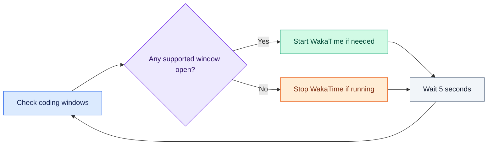

<div align="center">

# ⏱ WakaTime Monitor

**Open your editor. WakaTime starts. Close your editors. WakaTime stops.**

A quiet Windows companion that manages the WakaTime desktop app for you.


[](LICENSE)

[Quick start](#quick-start) · [Supported apps](#supported-apps) · [Controls](#everyday-controls) · [Troubleshooting](#troubleshooting)

</div>

---

## Small tool. One job.

| | What it does |
| :--- | :--- |
| **🪟 Window-aware** | Counts open and minimized coding windows in your Windows session. |
| **🌙 Runs hidden** | No terminal window while the monitor runs in the background. |
| **🔄 Recovers automatically** | Restarts WakaTime if it exits while a supported app is open. |
| **🚀 Ready at login** | Optional startup shortcut keeps the monitor available after signing in. |
| **📝 Leaves a trail** | Appends startup messages and start/stop actions to a local log. |

> [!NOTE]
> This tool manages the **WakaTime desktop app**. It does not measure keyboard activity or change your WakaTime tracking settings. An open supported window is the signal to keep WakaTime running.

## Quick start

### 1. Check the requirements

- **Windows 10 or 11**, with Windows PowerShell and Windows Script Host available.
- **WakaTime desktop app**, installed at the default path below. If yours is elsewhere, update `WAKATIME_EXE` in [the monitor script](src/wakatime-monitor.bat).
- **Git** to clone the repository, or download and extract the repository ZIP.

```text
%LOCALAPPDATA%\Programs\desktop-wakatime\WakaTime.exe
```

### 2. Start the monitor

Run in PowerShell:

```powershell
git clone https://github.com/SC136/wakatime-monitor.git
cd wakatime-monitor
wscript .\src\start-hidden.vbs
```

The launcher runs the monitor hidden and skips launching if it finds an existing monitor. Open a supported coding app to trigger WakaTime.

### 3. Enable startup at login · optional

```powershell
powershell -NoProfile -ExecutionPolicy Bypass -File .\setup\install-startup.ps1
```

This creates `WakaTime Monitor.lnk` in your Windows Startup folder. If you move the repository, run the command again to update the shortcut.

## What counts as “open”?



| App state | Keeps WakaTime running? |
| :--- | :---: |
| Supported app with an open window | **Yes** |
| Supported app with a minimized window | **Yes** |
| Background helper left behind after closing an app | **No** |
| Tray-only app with no open window | **No** |
| General browser or terminal window | **No** |

Each cycle includes a five-second wait plus the time needed to inspect windows. Start attempts have a short cooldown to allow WakaTime to launch.

## Supported apps

| Category | Apps |
| :--- | :--- |
| **Editors & IDEs** | VS Code, Zed, Visual Studio, Android Studio, Python IDLE, PowerShell ISE |
| **AI coding tools** | ChatGPT/Codex, Claude, Cursor, Qoder, Trae, Kiro, Antigravity, Antigravity IDE, Freebuff, ZCode, OpenCode, DeepSeek Harness, Context Hub, Orchestrator |
| **Embedded development** | Arduino IDE, Keil uVision |
| **Game development** | Unity Editor, Roblox Studio |
| **API & database tools** | Postman, MongoDB Compass |

ChatGPT/Codex supports both `ChatGPT.exe` and `Codex.exe` window processes. Python IDLE is identified by its launch command, so unrelated `pythonw.exe` GUI programs do not count.

### Add your own app

Find its executable name in **Task Manager → Details**, then append it to the existing `set APPS=` line in [src/wakatime-monitor.bat](src/wakatime-monitor.bat). Keep each name in quotes, including names with spaces.

```bat
REM Example only — retain the existing entries when adding your app.
set APPS="Code.exe" "Zed.exe" "Your Editor.exe"
```

Matching is case-insensitive. Restart the monitor after changing the list. New installations are not automatically added.

## Everyday controls

Run these commands from the repository folder in PowerShell:

| Task | Command |
| :--- | :--- |
| **Start hidden** | `wscript .\src\start-hidden.vbs` |
| **Run visibly for debugging** | `.\src\wakatime-monitor.bat` |
| **Stop monitor and WakaTime** | `.\setup\stop-monitor.bat` |
| **Enable login startup** | `powershell -NoProfile -ExecutionPolicy Bypass -File .\setup\install-startup.ps1` |
| **Remove login startup** | `powershell -NoProfile -ExecutionPolicy Bypass -File .\setup\uninstall-startup.ps1` |
| **Read recent activity** | `Get-Content .\logs\monitor.log -Tail 30` |

Removing the startup shortcut does not stop an already-running monitor. Use the stop command for that. Stop the hidden monitor before running a visible debug instance.

## Troubleshooting

<details>
<summary><strong>WakaTime does not start</strong></summary>

Check the configured executable path and confirm your app is in `APPS` with an open or minimized window. Run the monitor visibly to inspect errors. A missing WakaTime executable is logged, and the monitor exits.

</details>

<details>
<summary><strong>WakaTime stays running after I close my editor</strong></summary>

Check for another supported window, including minimized ChatGPT/Codex, Claude, API tools, or database tools. Background helpers alone should not count. After changing or updating the script, stop and restart the monitor to load the current configuration.

</details>

<details>
<summary><strong>The monitor does not start when I sign in</strong></summary>

Open `shell:startup` from Windows Run and look for `WakaTime Monitor.lnk`. Re-run the startup installer if the repository moved. Confirm Windows Script Host is available, then inspect `logs\monitor.log`.

</details>

<details>
<summary><strong>Where are the logs?</strong></summary>

The monitor appends to `logs\monitor.log` across restarts. It records its startup messages and actions, rather than every polling cycle. Logs stay local and are ignored by Git. WakaTime's own application output is separate.

</details>

## Inside the repository

```text
wakatime-monitor/
├── src/
│   ├── wakatime-monitor.bat      Monitor loop and WakaTime lifecycle
│   ├── check-coding-windows.ps1  Window and session detection
│   └── start-hidden.vbs          Hidden launcher with existing-instance check
├── setup/
│   ├── install-startup.ps1       Add the login shortcut
│   ├── uninstall-startup.ps1     Remove the login shortcut
│   └── stop-monitor.bat         Stop monitor and WakaTime
├── tests/
│   ├── check-coding-windows.ps1  Window-detection regression test
│   └── WindowFixture.cs         Temporary test-window source
└── logs/                        Local runtime logs, ignored by Git
```

### Verify window detection

Run in an interactive Windows desktop session with the .NET Framework 64-bit C# compiler available:

```powershell
powershell -NoProfile -ExecutionPolicy Bypass -File .\tests\check-coding-windows.ps1
```

The test briefly opens a temporary window, minimizes it, then closes it while leaving its process alive. It checks all three states, including an executable name containing spaces, and cleans up its fixture.

<details>
<summary><strong>Implementation notes</strong></summary>

The monitor uses built-in Windows batch, VBScript, and Windows PowerShell. System utilities are called by their full paths to avoid tools on `PATH` shadowing Windows commands.

Window detection checks the current Windows session and `MainWindowHandle`. If detection fails, the monitor logs an error and retries without changing WakaTime's state that cycle.

WakaTime's process state is checked every cycle so an unexpected exit can be recovered. Launches go through Explorer, and log lines are written individually rather than redirecting the monitor's entire output. Stopping WakaTime uses `taskkill /F`.

</details>

---

<div align="center">

Built for Windows · [MIT licensed](LICENSE)

</div>
