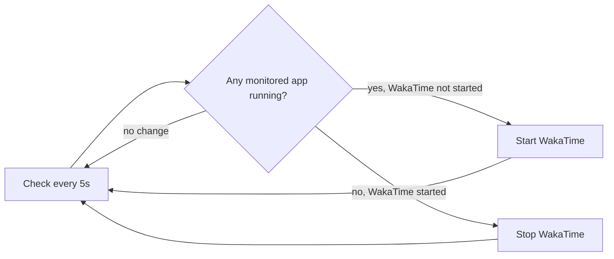

# WakaTime Monitor

A tiny Windows background tool that **starts the WakaTime desktop app when you
open a coding app and stops it when you close them all**, so WakaTime only runs
while you're actually coding.

- Uses built-in Windows batch, VBScript, and Windows PowerShell; no installs
- Runs fully hidden (no terminal window)
- Optional auto-start at Windows login
- Checks every 5 seconds, plus the time needed to inspect windows

## How it works



## Requirements

- Windows 10 / 11
- [WakaTime desktop app](https://wakatime.com/desktop-apps) installed at
  `%LOCALAPPDATA%\Programs\desktop-wakatime\WakaTime.exe` (the default location)

## Install

```powershell
git clone https://github.com/SC136/wakatime-monitor.git
cd wakatime-monitor

# Run it now, hidden
wscript src\start-hidden.vbs

# Optional: start automatically at every login
powershell -ExecutionPolicy Bypass -File setup\install-startup.ps1
```

If you move the folder later, run `install-startup.ps1` again so the startup
shortcut points to the new location.

## Usage

| Task | How |
| --- | --- |
| Run hidden | `wscript src\start-hidden.vbs` |
| Run with a visible window (debugging) | double-click `src\wakatime-monitor.bat` |
| Stop monitor and WakaTime | `setup\stop-monitor.bat` |
| Remove auto-start | `powershell -ExecutionPolicy Bypass -File setup\uninstall-startup.ps1` |
| See what it did | open `logs\monitor.log` |

Launching the hidden script twice is safe: only one monitor runs at a time.

## Monitored apps

VS Code, Zed, Claude, Qoder, Cursor, Trae, Kiro, Antigravity (and Antigravity
IDE), Freebuff, ZCode, Android Studio, Arduino IDE, Keil uVision, Visual Studio.
Also ChatGPT/Codex (`ChatGPT.exe` and `Codex.exe`), OpenCode, DeepSeek Harness,
Context Hub, Orchestrator, Unity Editor, Roblox Studio, Postman, MongoDB Compass,
Python IDLE, and PowerShell ISE. IDLE is identified by its launch command so
unrelated Python GUI apps do not count.

This is an explicit list of coding apps, not automatic detection of future
installs. General browsers, terminals, and tray services are not counted just
because they can be used for development.

To add or remove apps, edit the `set APPS=` line in `src\wakatime-monitor.bat`.
Use the exact process name from Task Manager, in quotes:

```bat
set APPS="Code.exe" "Zed.exe" "YourEditor.exe"
```

Matching is case-insensitive.
Names containing spaces are supported, including `Arduino IDE.exe`.
Only apps with an open window in your Windows session count. Minimized editor
windows count; background helpers and tray-only apps do not. Closing the last
editor window stops WakaTime even if an editor leaves helper processes running.

## Project layout

```
wakatime-monitor/
├── src/
│   ├── wakatime-monitor.bat    # monitor loop
│   ├── check-coding-windows.ps1 # distinguish editor windows from helpers
│   └── start-hidden.vbs        # hidden, single-instance launcher
├── setup/
│   ├── install-startup.ps1     # add auto-start at login
│   ├── uninstall-startup.ps1   # remove auto-start
│   └── stop-monitor.bat        # stop monitor + WakaTime
└── logs/                       # monitor.log (git-ignored)
```

## Troubleshooting

- **WakaTime never starts:** run `src\wakatime-monitor.bat` visibly and check
  the path it prints. If WakaTime is installed elsewhere, edit `WAKATIME_EXE`
  at the top of the script. Also confirm your editor's process name in Task
  Manager matches an entry in `APPS`.
- **Nothing happens at login:** check that `WakaTime Monitor.lnk` exists in
  `shell:startup`, then look at `logs\monitor.log`.
- **Noise from WakaTime itself** (registry or Firefox icon warnings, update
  checks) comes from the WakaTime app and is harmless. WakaTime is started
  detached from the monitor's own console, so its output never reaches
  `logs\monitor.log`.

### Implementation note

The script calls `tasklist`, `findstr`, `ping` and `taskkill` by their full
`System32` path. Tools such as Git for Windows put their own `find` and
`timeout` earlier on `PATH`, which silently breaks the Windows versions.

The monitor asks Windows whether `WakaTime.exe` is actually running on every
cycle, so a WakaTime that exits on its own (crash, update, manual quit) is
started again a few seconds later while a coding app is still open. It writes
`logs\monitor.log` line by line instead of redirecting its stdout, and starts
WakaTime through `explorer.exe`, so the app never inherits the log handle or the
monitor's job object.
Log entries are appended across monitor restarts. If the configured WakaTime
executable is missing, the monitor logs the error and exits.

## License

[MIT](LICENSE)
