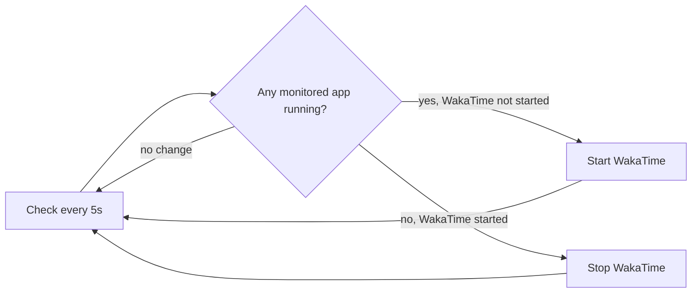

# WakaTime Monitor

A tiny Windows background tool that **starts the WakaTime desktop app when you
open a coding app and stops it when you close them all**, so WakaTime only runs
while you're actually coding.

- Zero dependencies: plain batch + VBScript, no installs
- Runs fully hidden (no terminal window)
- Optional auto-start at Windows login
- Very light: ~5-10 MB RAM, one short check every 5 seconds

## How it works



## Requirements

- Windows 10 / 11
- [WakaTime desktop app](https://wakatime.com/desktop-apps) installed at
  `%LOCALAPPDATA%\Programs\desktop-wakatime\WakaTime.exe` (the default location)

## Install

```powershell
git clone https://github.com/SC136/wakatime-monitor.git
cd wakatime-monitor

# Run it now, hidden
wscript src\start-hidden.vbs

# Optional: start automatically at every login
powershell -ExecutionPolicy Bypass -File setup\install-startup.ps1
```

If you move the folder later, run `install-startup.ps1` again so the startup
shortcut points to the new location.

## Usage

| Task | How |
| --- | --- |
| Run hidden | `wscript src\start-hidden.vbs` |
| Run with a visible window (debugging) | double-click `src\wakatime-monitor.bat` |
| Stop monitor and WakaTime | `setup\stop-monitor.bat` |
| Remove auto-start | `powershell -ExecutionPolicy Bypass -File setup\uninstall-startup.ps1` |
| See what it did | open `logs\monitor.log` |

Launching the hidden script twice is safe: only one monitor runs at a time.

## Monitored apps

VS Code, Zed, Claude, Qoder, Cursor, Trae, Kiro, Antigravity (and Antigravity
IDE), Freebuff, ZCode, Android Studio, Arduino IDE, Keil uVision, Visual Studio.

To add or remove apps, edit the `set APPS=` line in `src\wakatime-monitor.bat`.
Use the exact process name from Task Manager, in quotes:

```bat
set APPS="Code.exe" "Zed.exe" "YourEditor.exe"
```

Matching is case-insensitive.

## Project layout

```
wakatime-monitor/
├── src/
│   ├── wakatime-monitor.bat    # monitor loop
│   └── start-hidden.vbs        # hidden, single-instance launcher
├── setup/
│   ├── install-startup.ps1     # add auto-start at login
│   ├── uninstall-startup.ps1   # remove auto-start
│   └── stop-monitor.bat        # stop monitor + WakaTime
└── logs/                       # monitor.log (git-ignored)
```

## Troubleshooting

- **WakaTime never starts:** run `src\wakatime-monitor.bat` visibly and check
  the path it prints. If WakaTime is installed elsewhere, edit `WAKATIME_EXE`
  at the top of the script. Also confirm your editor's process name in Task
  Manager matches an entry in `APPS`.
- **Nothing happens at login:** check that `WakaTime Monitor.lnk` exists in
  `shell:startup`, then look at `logs\monitor.log`.
- **Noise from WakaTime itself** (registry or Firefox icon warnings, update
  checks) comes from the WakaTime app, is harmless, and is discarded when the
  monitor runs.

### Implementation note

The script calls `tasklist`, `findstr`, `ping` and `taskkill` by their full
`System32` path. Tools such as Git for Windows put their own `find` and
`timeout` earlier on `PATH`, which silently breaks the Windows versions.

## License

[MIT](LICENSE)
